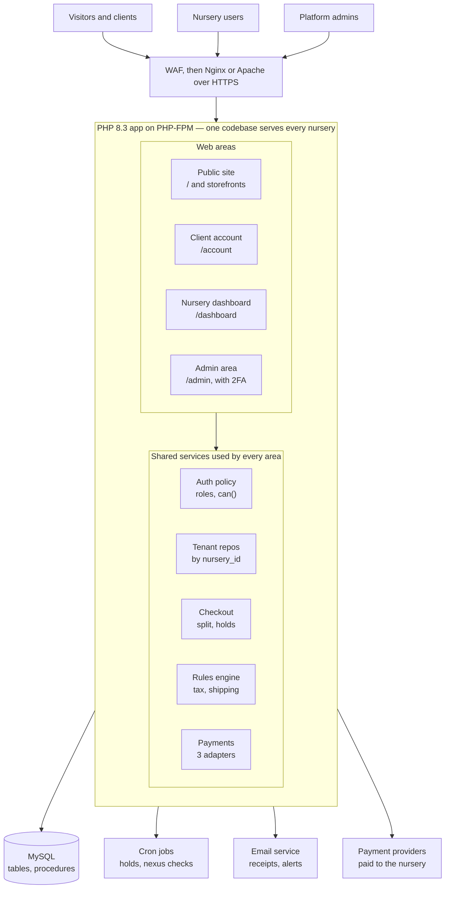
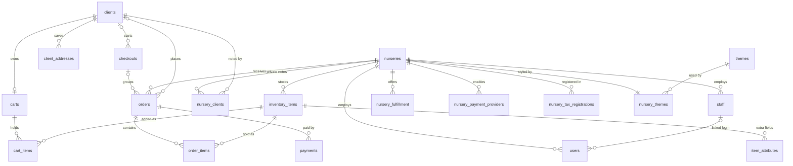
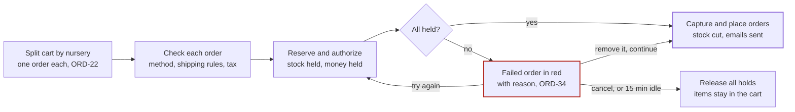

# NurseryNest — Design Document

Exported from the living design doc in Claude Docs on 2026-10-22. Diagrams are redrawn here in Mermaid.

## Overview

This document records only how NurseryNest will be built. What the system must do, its roles, permissions and open requirement questions live in [`requirements.md`](requirements.md) and are referenced here by ID (for example ORD-22) rather than repeated.

## Users and roles

Three separate identity stores keep the trust boundaries clean: nursery users (`users`), clients (`clients`) and platform admins (`platform_admins`), each with its own login (AUTH-8, ADM-5). Nursery staff and visitors have no login of their own.

**Permission checks:** the AUTH-9 matrix is coded once, as a `can($user, $action)` policy map keyed by role, rather than scattered `if role ==` checks. Confirming or changing the matrix is then a one-file edit, and the same map drives which dashboard menu items appear.

## Feature design

Each functional area maps to one application module; every module that touches nursery data scopes its queries by `nursery_id` (NUR-3).

### Nurseries and multi-tenancy

- **Model:** single database, shared tables, a `nursery_id` column on every nursery-owned row.
- **Enforcement:** the logged-in nursery user's `nursery_id` comes from the session only, never from a request parameter. A base repository class adds `WHERE nursery_id = ?` to every tenant query.
- **Admin bypass:** only the admin area uses an unscoped repository, and every call through it writes to `admin_audit_log`.

### Inventory and pricing

- "Days at nursery" (INV-4) is computed as today minus `date_received`, not stored.
- Price changes are a separate action from stock edits, so the permission check can tell them apart (AUTH-9).

### Branding and themes

- A theme is a layout template plus default CSS variables. At request time the layout loads the nursery's theme and writes its colours as CSS custom properties (`--brand-primary`, `--brand-secondary`), so one stylesheet serves every nursery.
- Theme screens exist only in the admin area.

### Client accounts and data sharing

- Nursery screens read client details only by joining through that nursery's own `orders`; no query lists clients directly (DATA-4).

### Cart

- One `carts` row per logged-in client or per visitor session. On login, the visitor cart merges into the client's saved cart.

### Checkout and orders

- The checkout sequence is in Key user flows.
- Guest order links use a random token; only its SHA-256 hash is stored in `orders.guest_access_token`.

### Payments

- The common payment interface (ORD-13) is a `PaymentProvider` PHP interface with `authorize`, `capture`, `void` and `refund`, and one adapter each for Stripe, PayPal and Square.
- Provider webhooks update `payments`; signatures are verified first, and a unique (provider, transaction ID) key makes repeats harmless.

### Sales tax

- A `TaxCalculator` service applies ORD-15 and ORD-16: it picks the address by fulfillment method, looks up the state and local rows effective on the order date, and stores both the rate and the amount on the order.

### Nexus tracking

- A nightly job reads the `nursery_state_sales` view, compares it with `state_nexus_thresholds`, and records each warning in `nexus_alerts` so it is sent only once.

### Shipping restrictions

- An item is blocked when a current rule matches its genus and species (a rule with no species covers the whole genus) for the destination state, or a USDA rule with no state matches it.

### Platform administration

- The `/admin` area has its own session cookie and uses TOTP codes for two-factor login.

## System architecture

NurseryNest is a single PHP application (a modular monolith) on one MySQL database, with four web areas sharing one set of services (TECH-1, NFR-5).

All four areas call the same tenant-scoped repositories, so nursery isolation is written once rather than per page.

| Layer | Technology | Notes |
| --- | --- | --- |
| Edge | WAF, Nginx or Apache, HTTPS | Blocks known attacks before patches land (NFR-9) |
| Application | PHP 8.3+ on PHP-FPM, Composer packages | Low-privilege system user (NFR-8, NFR-10) |
| Front end | Server-rendered templates, HTML, CSS custom properties, vanilla JavaScript | Theme colours injected per nursery (BRAND-3) |
| Data | MySQL, InnoDB, stored procedures for order placement | Least-privilege app account, never root (TECH-3, NFR-10) |
| Integrations | Stripe, PayPal, Square; transactional email | Behind the `PaymentProvider` interface (ORD-13) |
| Jobs | Cron-run PHP scripts | Reservation expiry, nexus checks, email queue |

**Request path:** router → area middleware (session, CSRF, role check) → controller → service → tenant-scoped repository → PDO prepared statement → template with escaped output.

## MySQL schema

The schema targets MySQL 8.0+ with InnoDB, so every relationship is a real foreign key and order placement runs in one transaction. Columns follow section 6 of the requirements; additions made by this design are marked *(added)*. The runnable script is [`database/01_schema.sql`](../database/01_schema.sql).

### Conventions

| Rule | Choice | Why |
| --- | --- | --- |
| Engine and charset | InnoDB, `utf8mb4`, `utf8mb4_0900_ai_ci` collation | Transactions, foreign keys, row locks; full Unicode in names and notes |
| Primary keys | `id BIGINT UNSIGNED AUTO_INCREMENT` | Simple joins; room well past 40 nurseries (NFR-4) |
| Foreign keys | `ON DELETE RESTRICT` by default; `CASCADE` only for child rows with no meaning alone (`item_attributes`, `cart_items`, `order_items`) | Orders and tax history are never deleted by accident |
| Tenant column | `nursery_id BIGINT UNSIGNED NOT NULL` on every nursery-owned table, first column of most indexes | Isolation and fast per-nursery queries (NUR-3) |
| Money | `DECIMAL(10,2)` | No floating-point rounding |
| Tax rates | `DECIMAL(7,5)`, stored as a fraction (6% = 0.06000) | Exact rates with surtax precision |
| Enumerations | `ENUM` for small fixed sets (role, status, method, provider) | Readable, validated by MySQL; changing one is a migration |
| Flexible data | `JSON` for rule and settings blobs (`nursery_fulfillment.rules`) | Nursery-specific rules without schema changes |
| Dates | `DATETIME` in UTC for events; `DATE` for effective ranges; `effective_to` NULL = still current | Dated rule rows (ORD-18) |
| Soft delete | `is_active` flags on nurseries, users, clients, admins | Keeps order history intact when an account is closed |
| Timestamps | `created_at`, `updated_at` with `DEFAULT CURRENT_TIMESTAMP` / `ON UPDATE CURRENT_TIMESTAMP` | Auditing and sync |
| States | `CHAR(2)` USPS codes (`FL`, `GA`) | Matches tax and shipping rule tables |

### Entity-relationship diagram

Every nursery-owned table references `nurseries`; clients span all nurseries.

`orders` and `nursery_clients` are the only tables that reference both a nursery and a client; `orders.client_id` is NULL for guest orders. Not drawn: `stock_reservations` references `checkouts` and `inventory_items`, `admin_audit_log` references `platform_admins`, and the rule tables (tax rates, nexus thresholds, shipping restrictions, `app_settings`) are looked up by state and date with no foreign keys.

### Tenancy and identity tables

Three login tables (`users`, `clients`, `platform_admins`) never share rows, and each email is unique within its own table (AUTH-8).

| Table | Columns | Keys and indexes |
| --- | --- | --- |
| `nurseries` | `id`, `slug VARCHAR(80)` *(added)*, `name VARCHAR(150)`, `address VARCHAR(255)`, `city VARCHAR(100)`, `county VARCHAR(60)` *(added)*, `zip VARCHAR(10)` *(added)*, `phone VARCHAR(30)`, `email VARCHAR(255)`, `hours JSON`, `description TEXT`, `is_active TINYINT(1)` *(added)*, `created_at DATETIME` | PK `id`; UNIQUE `slug` (storefront URL); county and zip give the pickup tax rate (ORD-16) |
| `themes` | `id`, `name VARCHAR(100)`, `layout VARCHAR(100)`, `default_settings JSON` | PK `id`; UNIQUE `name` |
| `nursery_themes` | `nursery_id`, `theme_id`, `logo_path VARCHAR(255)`, `primary_color CHAR(7)`, `secondary_color CHAR(7)`, `banner_path VARCHAR(255)`, `updated_at DATETIME` | PK `nursery_id` (one theme per nursery); FK `theme_id` → `themes` |
| `staff` | `id`, `nursery_id`, `name VARCHAR(150)`, `position VARCHAR(100)`, `email VARCHAR(255)`, `phone VARCHAR(30)`, `hire_date DATE` | PK `id`; FK `nursery_id`; INDEX (`nursery_id`, `name`) |
| `users` | `id`, `nursery_id`, `staff_id NULL`, `email VARCHAR(255)`, `password_hash VARCHAR(255)`, `role ENUM('nursery_manager','office_admin','inventory_coordinator','sales_rep')`, `is_active TINYINT(1)`, `last_login DATETIME NULL`, `created_at DATETIME` | PK `id`; UNIQUE `email`; FK `nursery_id`, FK `staff_id` → `staff` (SET NULL); INDEX (`nursery_id`, `role`) |
| `clients` | `id`, `name VARCHAR(150)`, `email VARCHAR(255)`, `password_hash VARCHAR(255)`, `phone VARCHAR(30)`, `is_active TINYINT(1)` *(added)*, `created_at DATETIME`, `last_login DATETIME NULL` | PK `id`; UNIQUE `email` |
| `client_addresses` | `id`, `client_id`, `label VARCHAR(50)`, `address VARCHAR(255)`, `city VARCHAR(100)`, `state CHAR(2)` *(added)*, `county VARCHAR(60)` *(added)*, `zip VARCHAR(10)` | PK `id`; FK `client_id` (CASCADE); state and county drive tax and shipping rules (ORD-15, ORD-29) |
| `nursery_clients` | `nursery_id`, `client_id`, `notes TEXT`, `updated_at DATETIME` | PK (`nursery_id`, `client_id`); both FKs (DATA-4) |
| `platform_admins` | `id`, `name VARCHAR(150)`, `email VARCHAR(255)`, `password_hash VARCHAR(255)`, `two_factor_secret VARBINARY(255)` (encrypted), `is_active TINYINT(1)`, `last_login DATETIME NULL` | PK `id`; UNIQUE `email` |
| `admin_audit_log` | `id`, `admin_id`, `action VARCHAR(100)`, `target_type VARCHAR(50)`, `target_id BIGINT UNSIGNED`, `details JSON`, `ip_address VARBINARY(16)` *(added)*, `created_at DATETIME` | PK `id`; FK `admin_id`; INDEX (`admin_id`, `created_at`), (`target_type`, `target_id`); triggers block UPDATE and DELETE for every account (ADM-6) |
| `password_resets` *(added)* | `id`, `account_type ENUM('user','client','admin')`, `account_id BIGINT UNSIGNED`, `token_hash CHAR(64)`, `expires_at DATETIME`, `used_at DATETIME NULL` | PK `id`; UNIQUE `token_hash`; INDEX (`account_type`, `account_id`) (AUTH-4) |

### Catalogue, cart, order and payment tables

Orders copy every price, rate and name they depend on, so editing or removing an item never changes a past order (ORD-17, ORD-18).

| Table | Columns | Keys and indexes |
| --- | --- | --- |
| `inventory_items` | `id`, `nursery_id`, `name VARCHAR(150)`, `category VARCHAR(80)`, `genus VARCHAR(80) NULL`, `species VARCHAR(80) NULL`, `description TEXT`, `quantity INT UNSIGNED`, `price DECIMAL(10,2)`, `date_received DATE NULL`, `florida_only TINYINT(1)`, `is_active TINYINT(1)` *(added)*, `updated_at DATETIME` | PK `id`; FK `nursery_id`; INDEX (`nursery_id`, `category`), (`genus`, `species`); FULLTEXT (`name`, `description`) for search (CLI-3). Removing an item sets `is_active = 0` so old orders keep their link. Genus and species are NULL for non-plant products |
| `item_attributes` | `id`, `item_id`, `attribute_name VARCHAR(80)`, `attribute_value VARCHAR(255)` | PK `id`; FK `item_id` (CASCADE); UNIQUE (`item_id`, `attribute_name`) (INV-5) |
| `carts` | `id`, `client_id NULL`, `session_id VARCHAR(128) NULL`, `updated_at DATETIME` | PK `id`; UNIQUE `client_id`; UNIQUE `session_id`; CHECK exactly one is set (ORD-24) |
| `cart_items` | `id`, `cart_id`, `item_id`, `nursery_id`, `quantity INT UNSIGNED`, `added_at DATETIME` | PK `id`; FK `cart_id` (CASCADE), `item_id`, `nursery_id`; UNIQUE (`cart_id`, `item_id`); `nursery_id` copied from the item for grouping (ORD-21) |
| `checkouts` | `id`, `client_id NULL`, `status ENUM('open','authorizing','completed','cancelled','expired')` *(added)*, `expires_at DATETIME` *(added)*, `created_at DATETIME` | PK `id`; FK `client_id`; INDEX (`status`, `expires_at`) for the expiry job (ORD-36). `client_id` is NULL for guest checkouts |
| `stock_reservations` *(added)* | `id`, `checkout_id`, `item_id`, `quantity INT UNSIGNED`, `expires_at DATETIME` | PK `id`; FK `checkout_id` (CASCADE), `item_id`; INDEX `expires_at` (ORD-33) |
| `orders` | `id`, `nursery_id`, `client_id NULL`, `checkout_id NULL`, `guest_name VARCHAR(150)`, `guest_email VARCHAR(255)`, `guest_phone VARCHAR(30)`, `shipping_address VARCHAR(255)`, `shipping_city VARCHAR(100)` *(added)*, `shipping_zip VARCHAR(10)` *(added)*, `shipping_state CHAR(2)`, `shipping_county VARCHAR(60)`, `fulfillment_method ENUM('pickup','delivery','shipping')`, `status ENUM('pending','paid','ready_for_pickup','shipped','completed','cancelled')`, `subtotal DECIMAL(10,2)`, `fulfillment_fee DECIMAL(10,2)`, `tax DECIMAL(10,2)`, `tax_rate DECIMAL(7,5)` *(added)*, `total DECIMAL(10,2)`, `guest_access_token CHAR(64) NULL` (SHA-256 of the emailed token), `created_at DATETIME`, `updated_at DATETIME` | PK `id`; FK `nursery_id`, `client_id`, `checkout_id`; INDEX (`nursery_id`, `status`, `created_at`), (`client_id`, `created_at`), (`nursery_id`, `shipping_state`, `created_at`) for nexus totals; UNIQUE `guest_access_token` |
| `order_items` | `id`, `order_id`, `item_id`, `item_name VARCHAR(150)` *(added)*, `quantity INT UNSIGNED`, `unit_price DECIMAL(10,2)` | PK `id`; FK `order_id` (CASCADE), `item_id` (RESTRICT) |
| `payments` | `id`, `order_id`, `provider ENUM('stripe','paypal','square')`, `provider_transaction_id VARCHAR(255)`, `type ENUM('authorization','capture','void','refund')` *(added)*, `amount DECIMAL(10,2)`, `status ENUM('pending','succeeded','failed')`, `failure_reason VARCHAR(255) NULL` *(added)*, `created_at DATETIME` | PK `id`; FK `order_id`; UNIQUE (`provider`, `provider_transaction_id`) so a repeated webhook is ignored; one row per provider call, so refunds and voids keep their own history (ORD-8, ORD-34) |

### Settings, tax and rule tables

Every rule that changes over time is a dated row, looked up by the order date, so a new rate or threshold is an insert and never a code change (ORD-18, ORD-31, TAX-2).

| Table | Columns | Keys and indexes |
| --- | --- | --- |
| `nursery_fulfillment` | `id`, `nursery_id`, `method ENUM('pickup','delivery','shipping')`, `is_enabled TINYINT(1)`, `fee DECIMAL(10,2)`, `rules JSON` (delivery ZIPs or radius, pickup hours, shipping fee bands) | PK `id`; FK `nursery_id`; UNIQUE (`nursery_id`, `method`) (ORD-9, ORD-11) |
| `nursery_payment_providers` | `id`, `nursery_id`, `provider ENUM('stripe','paypal','square')`, `is_enabled TINYINT(1)`, `account_ref VARCHAR(255)` | PK `id`; FK `nursery_id`; UNIQUE (`nursery_id`, `provider`). Secrets live in an encrypted store outside MySQL; `account_ref` points to them (NFR-10) |
| `nursery_tax_registrations` | `id`, `nursery_id`, `state_code CHAR(2)`, `registration_number VARCHAR(50)`, `registered_on DATE`, `is_active TINYINT(1)` | PK `id`; FK `nursery_id`; UNIQUE (`nursery_id`, `state_code`) (TAX-4) |
| `state_tax_rates` | `id`, `state_code CHAR(2)`, `state_name VARCHAR(50)`, `rate DECIMAL(7,5)`, `has_local_taxes TINYINT(1)`, `effective_from DATE`, `effective_to DATE NULL`, `notes VARCHAR(255)` | PK `id`; INDEX (`state_code`, `effective_from`) |
| `local_tax_rates` | `id`, `state_code CHAR(2)`, `jurisdiction ENUM('county','city','district')`, `name VARCHAR(100)`, `zip_code VARCHAR(10) NULL`, `rate DECIMAL(7,5)`, `effective_from DATE`, `effective_to DATE NULL`, `notes VARCHAR(255)` | PK `id`; INDEX (`state_code`, `jurisdiction`, `name`, `effective_from`), (`zip_code`). Florida's 67 county surtaxes are `jurisdiction = 'county'` rows |
| `state_nexus_thresholds` | `id`, `state_code CHAR(2)`, `sales_threshold DECIMAL(12,2) NULL`, `transaction_threshold INT UNSIGNED NULL`, `threshold_logic ENUM('sales','transactions','either','both')`, `period ENUM('calendar_year','prior_or_current_year','rolling_12_months')`, `effective_from DATE`, `effective_to DATE NULL`, `notes VARCHAR(255)` | PK `id`; INDEX (`state_code`, `effective_from`) (TAX-2) |
| `nexus_alerts` *(added)* | `id`, `nursery_id`, `state_code CHAR(2)`, `year SMALLINT`, `level ENUM('80','100')`, `sent_at DATETIME` | PK `id`; UNIQUE (`nursery_id`, `state_code`, `year`, `level`) so each warning is sent once (TAX-3) |
| `plant_shipping_restrictions` | `id`, `state_code CHAR(2) NULL` (NULL = a USDA rule for every destination outside Florida), `genus VARCHAR(80)`, `species VARCHAR(80) NULL` (NULL = whole genus), `rule VARCHAR(255)` (reason shown at checkout), `source VARCHAR(255)`, `effective_from DATE`, `effective_to DATE NULL` | PK `id`; INDEX (`genus`, `species`, `state_code`) (ORD-29 to ORD-31) |
| `app_settings` *(added)* | `setting_key VARCHAR(80)`, `setting_value VARCHAR(255)`, `updated_at DATETIME` | PK `setting_key`; holds `tax_fulfillment_fees` until open question 16 is answered |

**View `nursery_state_sales` (TAX-1, TAX-5)** groups `orders` with status paid, ready for pickup, shipped or completed by `nursery_id`, destination state (pickup counts as `FL`) and `YEAR(created_at)`. It returns `total_sales` (total minus tax), `order_count` and `tax_collected`, and is served by the (`nursery_id`, `shipping_state`, `created_at`) index on `orders`.

**Stored procedure `sp_place_order(order_id)` (TECH-3, ORD-4)**

1. Start a transaction.
2. Lock each ordered item's row in `inventory_items` with `SELECT … FOR UPDATE` in one locking read.
3. If any `quantity` is below the ordered amount, roll back and signal an out-of-stock error naming the item.
4. Subtract each ordered amount from `quantity`.
5. Delete that checkout's `stock_reservations` rows for the order's items.
6. Commit. PHP then captures the payment and sets the order to paid.

**Users and grants (NFR-10):** the app account gets SELECT, INSERT, UPDATE, DELETE and EXECUTE on the database, and triggers make `admin_audit_log` append-only; migrations run under a separate admin account.

## Key user flows

Checkout is the riskiest flow: several nurseries, several providers and held stock must succeed or fail together (ORD-33 to ORD-36).

**Multi-nursery checkout, step by step**

1. Group cart items by `nursery_id`; create a `checkouts` row and one draft order per nursery.
2. For each order the client picks a fulfillment method and address; the rules engine flags restricted plants and computes fee and tax.
3. Insert `stock_reservations` (15-minute expiry) and call `authorize` on each nursery's chosen provider.
4. All held: in one transaction, run the place-order procedure per order (lock rows, decrement stock), then `capture` each payment, set status to paid and queue confirmations.
5. Any failure: show that order in red. Try again re-authorizes only that order; Remove drops it and runs step 4 for the rest; Cancel calls `void` on every hold and releases stock.

**Guest checkout (ORD-25 to ORD-27)**

1. Runs the same checkout sequence as above, with one order and `client_id` NULL.
2. The emailed status link carries the raw token; the order stores only its hash.
3. On sign-up, orders whose guest email matches the new account and whose token the guest presents move to the new `client_id`.

**Nexus alert (TAX-1 to TAX-3)**

1. Nightly cron job reads `nursery_state_sales` for the current year.
2. Compares each row with the state's `state_nexus_thresholds` row effective today.
3. For each level crossed with no `nexus_alerts` row yet, inserts the row, queues the emails and sets a dashboard banner.

## UI and screens

The product has five areas, each with its own layout and URL prefix; all are responsive from phone to desktop (NFR-3).

| Area | URL prefix | Look | Main screens |
| --- | --- | --- | --- |
| Public site | `/` | NurseryNest brand | Marketing pages and logins (WEB-1 to WEB-5) |
| Nursery storefront | `/n/{slug}` | That nursery's theme | Profile and hours, inventory list with search and filters, item detail, cart (WEB-6, ORD-1) |
| Client account | `/account` | NurseryNest brand | All-nursery browse and search, cart, checkout, order history and detail, profile and addresses (CLI-3 to CLI-6) |
| Nursery dashboard | `/dashboard` | That nursery's theme | Overview, inventory, orders, clients, staff, users and roles, settings (profile, fulfillment, payments, tax registrations), tax reports, nexus alerts |
| Admin area | `/admin` | Plain admin style | Nurseries, themes, users, clients, tax rates, nexus thresholds, shipping rules, audit log (ADM-2 to ADM-6) |

**Navigation rules**

- Dashboard menu items appear only when the `can()` policy allows them. Hiding a menu item is cosmetic; the server always re-checks.
- Storefront and dashboard apply the nursery's theme through CSS custom properties.

**Front-end approach:** server-rendered PHP templates with small vanilla JavaScript modules for the cart, checkout and filters, matching the stack in TECH-1. No single-page-app framework is needed.

## Security, privacy and compliance

The biggest risk is one nursery seeing another's data, so isolation is enforced in the data layer, not left to each page (NUR-3, NFR-2).

| Area | Design | Requirements |
| --- | --- | --- |
| Tenant isolation | `nursery_id` from the session only; scoped base repository; automated tests that try another nursery's IDs on every endpoint | NUR-3, NFR-2 |
| Client privacy | Nurseries reach client data only through their own orders | DATA-4 |
| Passwords | Rehash on login when PHP's default algorithm changes | AUTH-2 |
| Sessions | Regenerate session ID on login; `HttpOnly`, `Secure`, `SameSite=Lax` cookies; separate cookies for client, nursery and admin areas | AUTH-3, ADM-5 |
| Password reset | Single-use random token stored hashed in `password_resets`, short expiry, same response whether or not the email exists | AUTH-4 |
| Output | `htmlspecialchars` in templates plus a Content Security Policy header | NFR-1 |
| Forms | Per-session CSRF token on every state-changing request | NFR-1 |
| Transport | HSTS header | NFR-1 |
| Payment secrets | Encrypted with a key kept outside the database; `account_ref` points to them | NFR-10 |
| Guest order links | Token hashed at rest, compared in constant time | ORD-26 |
| Audit log | Triggers block UPDATE and DELETE on `admin_audit_log` | ADM-6 |
| Patching | `composer audit` runs in CI | NFR-11 |
| Rate limiting | Throttle logins and password resets per account and IP (proposed) | AUTH-3, AUTH-4 |

## Non-functional requirements

The shared-table design scales to hundreds of nurseries on one MySQL server; the main levers are indexes on `nursery_id` and caching public pages.

| Concern | Design | Requirements |
| --- | --- | --- |
| Scalability | `nursery_id`-first indexes; stateless PHP-FPM workers that can be added behind a load balancer; sessions in the database or Redis rather than local files | NFR-4 |
| Backups | Nightly full dump plus binary logs for point-in-time recovery | NFR-6 |
| Background jobs | Cron-driven PHP scripts: release expired reservations (every minute), nexus check (nightly), email queue | ORD-36, TAX-3 |
| Email | Transactional email service, sent from a queue so checkout is not blocked | ORD-6 |
| Monitoring | Error logging; alerts on failed payments and webhook failures | NFR-11 |

## Open questions

Three design decisions are still open; requirement questions are tracked in section 7 of the requirements.

- [ ] Approve the added tables and columns marked *(added)* in MySQL schema, including `stock_reservations` for held stock.
- [ ] Confirm Stripe, PayPal and Square each support authorize-then-capture for every payment method a nursery enables, and how long a hold lasts.
- [ ] Choose the transactional email service and the hosting setup (single server or load-balanced).
